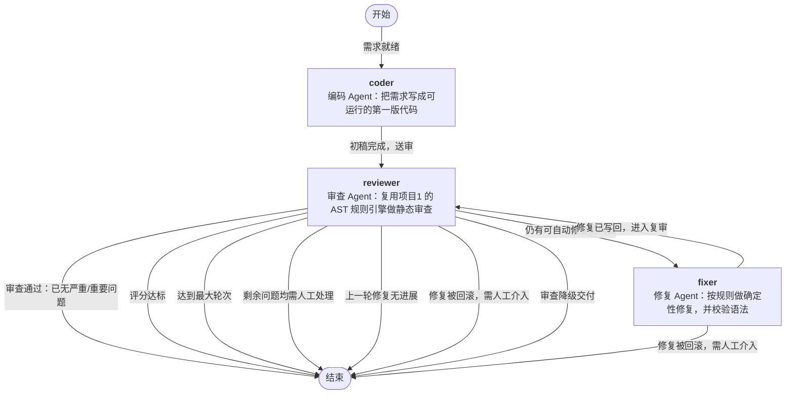

# 多 Agent 协作 Workflow（agent-workflow）

> **编码 → 审查 → 修复 → 复审**：三个 Agent 通过**共享状态**与**消息总线**协作，
> 用**条件分支 + 循环**自动收敛——审查发现问题就叫修复 Agent 改，改完自动复审，直到达标或无可自动修复项。
> **零第三方依赖**（纯 Python 标准库），审查节点**直接复用项目1 的代码审查 Agent**。

```bash
python run.py run --mock          # 无需联网、无需密钥，一条命令看到完整流程
```

```
▶ 流程启动：code-review-loop  入口=coder  节点数=3
[01] ▶ coder      编码 Agent：把需求写成可运行的第一版代码
        ✉ coder → reviewer [code_ready] solution.py 已就绪（1892 字符）
[01] ✓ coder      生成初稿 solution.py（来源：离线 Mock 模板（记录导出工具））
        └─ 走边 coder → reviewer  「初稿完成，送审」
[02] ▶ reviewer   审查 Agent：复用项目1 的 AST 规则引擎做静态审查
        ✉ reviewer → fixer [review_done] 第 1 轮审查：15 条问题（严重 1 / 重要 6），评分 24
[02] ✓ reviewer   第 1 轮：15 条问题（c1/M6/m6/i2），评分 24
        └─ 走边 reviewer → fixer  「仍有可自动修复的问题」
[03] ▶ fixer      修复 Agent：按规则做确定性修复，并校验语法
        ✉ fixer → reviewer [fix_applied] 第 1 轮修复：改动 3 处，6 项需人工，6 处留待下一轮
[03] ✓ fixer      第 1 轮修复：改动 3 处（受每轮上限 3 处限制，6 处顺延）
        └─ 走边 fixer → reviewer  「修复已写回，进入复审」
[04] ✓ reviewer   第 2 轮：13 条问题（c1/M5/m5/i2），评分 29     ← 循环回到审查
      ……（第 2、3 轮修复：3 处 → 2 处）
[08] ✓ reviewer   第 4 轮：8 条问题（c1/M1/m4/i2），评分 51
        └─ 走边 reviewer → __end__  「剩余问题均需人工处理」
■ 流程结束：满足结束条件并退出：剩余问题均需人工处理  共 8 步，0.09s

评分演化：24 → 29 → 39 → 51      自动修复累计 8 处      需人工处理 8 项
```

完整运行报告（含流程图、消息流水、状态审计、最终代码）见 [`docs/example-run.md`](docs/example-run.md)。
**注意剩下的 8 项不是失败**：复杂度重构、`eval` 语义这类问题机械替换只会更糟，报告会逐条说明为什么不能自动修。

---

## 作业要求对照

| 作业要求 | 本项目实现 | 代码 |
| --- | --- | --- |
| **≥2 个 Agent 协作完成完整流程** | 3 个 Agent：编码 / 审查 / 修复，端到端跑通「需求 → 可运行代码」 | [`workflow/agents/`](workflow/agents) |
| **实现 Agent 间消息传递或状态共享** | **两者都做**：黑板（产物 + 版本 + 审计）+ 消息总线（定向 + 广播 + 存档） | [`state.py`](workflow/state.py)、[`message.py`](workflow/message.py) |
| **支持基本流程控制（顺序执行）** | 引擎按边推进：编码 → 审查 → 修复 | [`engine.py`](workflow/engine.py) |
| 推荐：**条件分支** | 审查后 8 条出边按优先级择一：7 种「结束原因」+ 1 条「继续修复」 | [`flows/review_loop.py`](flows/review_loop.py) |
| 推荐：**循环** | 修复 → 复审 → 修复…… 由轮次上限与「无进展」判定收敛 | 同上 |
| 推荐：**并行执行** | `ParallelNode` 并发跑子节点并汇合产物（拒绝重叠写入，避免竞态） | [`node.py`](workflow/node.py) |
| 推荐：**执行日志与状态追踪** | 每步抛出结构化事件（JSONL）+ 状态变更审计流水 | [`events.py`](workflow/events.py) |
| 推荐：**错误处理与恢复** | 可重试异常 + 指数退避、`on_error` 错误恢复边、修复后语法校验回滚 | [`engine.py`](workflow/engine.py) |
| 推荐：**可视化编排界面（可选）** | `python run.py graph --format mermaid` 导出流程图，报告内嵌 Mermaid | [`graph.py`](workflow/graph.py) |
| **从项目1 复用 Agent** | 审查节点**就是**项目1 的 `ReviewAgent`，以 vendored 方式内置 | [`agents/reviewer.py`](workflow/agents/reviewer.py) |

---

## 快速开始

要求 **Python 3.9+**（实测 3.13 / 3.14），**不需要安装任何第三方库**，也不需要先安装项目1。

```bash
python run.py run                                     # 用内置示例需求跑完整流程
python run.py run --spec "写一个 CSV 去重工具"          # 自定义需求
python run.py run --fix-budget 3 --max-rounds 6        # 每轮最多改 3 处 → 看到多轮循环
python run.py run --out report.md                      # 报告另存
python run.py graph --format mermaid                   # 导出流程图
python run.py run --flow metrics-parallel --scan .     # 第二条流程：并行代码度量（分析本项目）
python run.py agents                                   # 查看 Agent 的读写状态声明
python run.py rules                                    # 可自动修复 / 需人工的规则清单
```

接入真实大模型（复用项目1 的配置体系，`CR_API_KEY` 等环境变量同样生效）：

```bash
python run.py run --base-url https://api.deepseek.com/v1 --api-key sk-xxx --model deepseek-chat
```

> **Windows 编码提示**：程序输出已强制 UTF-8；要保存结果请用 `--out`，不要用 `>`（PowerShell 会写成 UTF-16）。

---

## 流程图



7 条结束边各自对应一种「为什么停」，流程图因此自带说明；引擎会把命中的边标签原样写进报告的终止原因。

### 第二条流程：并行代码度量

`--flow metrics-parallel` 是另一条流程，用来证明**「引擎与业务分离」不是口号**——
新增它时 `workflow/` 引擎一行都没改：

```
开始 ─▶ 扫描文件 ─┬─▶ 统计行数    ─┬─▶ 汇总 Markdown 报告 ─▶ 结束
                  ├─▶ 度量复杂度   ─┤      （分析器等能力复用项目1）
                  └─▶ 扫描 TODO    ─┘
```

```
$ python run.py run --flow metrics-parallel --scan . --mock
[02] ✓ analyze    并行完成 → count_lines: 10271 行（代码 8220）；
                  measure_complexity: 524 个函数，最高复杂度 47；find_todos: 5 处待办  (1219ms)
```

三个子节点的输入互不依赖，并行是顺理成章的选择——不是为了演示硬塞。输出见
[`docs/metrics-report.md`](docs/metrics-report.md)。

---

## 三个 Agent

| Agent | 角色 | 读取 | 写入 | 两种模式 |
| --- | --- | --- | --- | --- |
| `coder` | 把需求写成可运行的第一版代码 | `spec` `workspace` | `code` `code_path` `code_history` `round` | LLM 写代码 / 离线模板选初稿 |
| `reviewer` | **复用项目1 的审查 Agent** 做静态审查 | `code_path` `workspace` | `review` `findings` `review_history` | 项目1 的完整 ReAct 审查循环 |
| `fixer` | 按审查结论做确定性修复，并校验语法 | `code_path` `findings` `round` `fix_budget` | `code` `fix_log` `manual_items` `round` | 规则修复 / LLM 修复 |

三个 Agent **互不引用**，只声明「读什么、写什么」——换掉任何一个（比如把规则修复换成 LLM 修复）不影响其他两个。

> 离线 Mock 模式的编码 Agent 从内置模板按关键词选「朴素初稿」，**它并不真的理解需求**；真实编码能力只在 LLM 模式下具备。这一点在报告和本文档里都如实标注。

---

## 引擎能力

| 能力 | 说明 |
| --- | --- |
| 顺序 / 条件分支 | 按 `priority` 评估出边，走第一条成立的；标签即文档 |
| 循环 | 修复 → 复审闭环；由轮次上限、无进展、无可修复项共同收敛 |
| 并行 | `ParallelNode` 线程池并发 + 产物汇合；子节点写入同一状态键直接报错（防竞态） |
| 重试 | 节点失败按 `retries` 重试，退避可配；`NodeRetryableError` 显式标记可重试 |
| 错误恢复 | `on_error` 边把失败导向兜底节点，而不是让整条流程崩掉 |
| 三道保护 | 步数硬上限（`--max-steps`）、轮次上限（`--max-rounds`）、失败不静默（一定有 `node_error` 事件） |
| 可观测 | 事件流 + 状态审计 + 消息存档，三者都可导出 JSON |

---

## 修复规则

```bash
python run.py rules      # 随时查看清单
```

* **可自动修复 7 条**（按 `规则名 + 行号` 精确定位）：`== None`、裸 `except`、`except: pass`、未使用导入、可变默认参数、硬编码凭据、缺文档字符串
* **需人工处理 17 条**：圈复杂度、`eval` 执行、`os.system`、`shell=True`、`pickle.loads`、函数重复定义…… 每一条都带「为什么不能自动修」的说明

**四条底线**：只改报告点到的地方（不做顺手重构）/ 改完必须能编译（`ast.parse` 不过就整轮丢弃）/ 修不了要说出来（不静默忽略）/ 没有进展就停（不空转烧轮次）。

---

## 项目结构

```
code-review-workflow/
├── run.py                  # 入口（免安装即可运行）
├── README.md / DESIGN.md   # 使用说明 / 设计文档
├── workflow/               # 引擎与 Agent（约 3200 行，不含 vendored）
│   ├── state.py            #   共享状态（黑板）：版本化 + 审计
│   ├── message.py          #   消息总线：定向 / 广播 / 存档
│   ├── node.py             #   节点抽象：函数 / Agent / 并行
│   ├── graph.py            #   流程定义 + 校验 + Mermaid 导出
│   ├── engine.py           #   执行引擎：顺序 / 分支 / 循环 / 重试 / 恢复
│   ├── events.py           #   事件与执行日志
│   ├── report.py           #   运行报告渲染
│   ├── cli.py              #   命令行界面
│   └── agents/             #   三个 Agent + 确定性修复规则（1176 行）
├── flows/                  # 两条流程定义（引擎与业务分离，新增流程不用改引擎）
├── codereview/             # vendored：项目1 的代码审查 Agent（17 个模块 / 5331 行）
├── docs/                   # 示例运行报告 / 度量报告 / 流程图 / 运行日志
└── tests/                  # 143 个单元测试（约 1400 行）
```

---

## 测试

```bash
python -m unittest discover -s tests -t .     # 143 个用例，约 1.5 秒，零依赖
```

| 测试文件 | 覆盖内容 |
| --- | --- |
| [`test_state.py`](tests/test_state.py) | 状态版本化、审计记录、消息总线 |
| [`test_graph.py`](tests/test_graph.py) | 流程校验、边优先级、Mermaid 渲染、并行节点竞态拦截 |
| [`test_engine.py`](tests/test_engine.py) | 顺序、分支、**循环**、步数保护、重试、错误恢复、事件流 |
| [`test_repairs.py`](tests/test_repairs.py) | 7 条修复规则 + **两个真实 Bug 的回归测试**（多行签名被插坏、docstring 被降级） |
| [`test_flow.py`](tests/test_flow.py) | 端到端跑通、**评分真的提升**、消息与状态协作、多轮循环、8 种终止原因 |
| [`test_metrics_flow.py`](tests/test_metrics_flow.py) | 第二条流程：并行产物汇合、度量准确性、扫描范围 |
| [`test_cli.py`](tests/test_cli.py) | 各子命令、退出码、`--json` 纯 JSON 输出 |

---

## 与项目1 的关系

* **复用了什么**：整个审查 Agent（26 条 AST 规则、路径沙箱、上下文压缩、降级交付）、配置体系（`CR_*` 环境变量）、终端着色、UTF-8 输出处理。审查环节**一行都没重写**。
* **怎么复用**：`codereview/` 以 vendored 方式内置，因此本项目 clone 下来即可独立运行，不需要先安装项目1。
* **新增了什么**：Workflow 引擎（节点/条件边/执行引擎）、共享状态与消息总线、确定性与 LLM 双模式的编码与修复 Agent、运行报告与流程图导出。

---

## 已知限制

1. **离线 Mock 模式的编码 Agent 不真的理解需求**，只按关键词选模板；真实编码能力需要 LLM。
2. **修复规则只覆盖 7 类问题**，且都是「局部、语义确定」的改动；涉及设计的问题一律交给人工。
3. **并行执行用在 `metrics-parallel` 流程里**；`review-loop` 是串行的——编码 → 审查 → 修复天然有前后依赖，硬塞并行只是为演示而演示。
4. **没有持久化**：状态与消息都在内存里，进程结束即消失（MVP 范围）。
5. **Web 编排界面未做**（作业标为可选），可视化通过 Mermaid 导出与终端流程图提供。

> [`codereview/`](codereview) 与示例代码中出现的 `sk-...`、`SECRET_TOKEN = "..."` 等**全部是虚构字符串**，且都是被审查的「反面教材」，请勿在真实环境使用。
